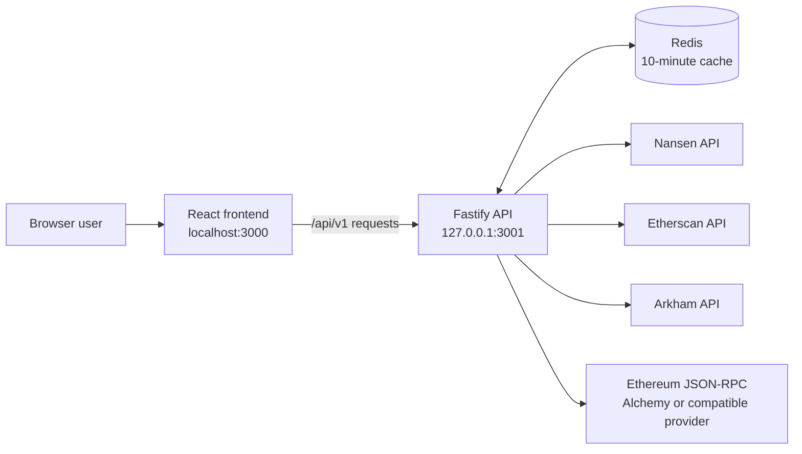
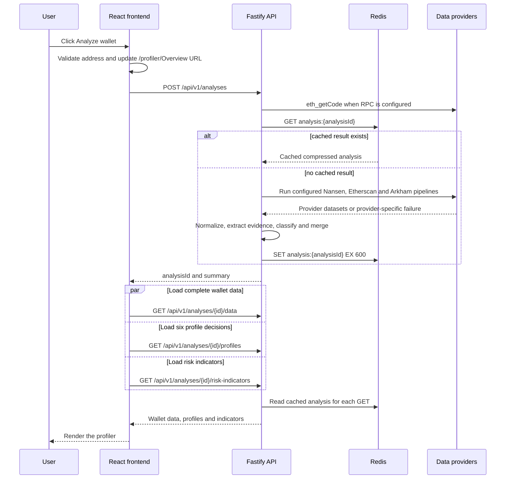
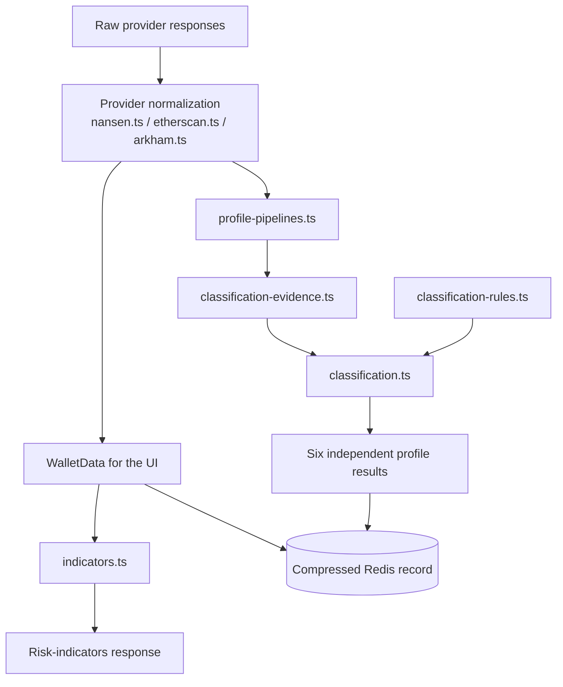

# OnChain Wallet Profiler: project and request-flow guide

This guide describes the current repository structure, the frontend and backend startup paths, and the exact request flow started by **Analyze wallet**. It is based on the implementation in this repository.

## System overview

The project has three running parts:

1. A React and Vite frontend on `http://localhost:3000`.
2. A Fastify API on `http://127.0.0.1:3001`.
3. Redis, used to cache completed analysis records for 10 minutes.

The backend can use Nansen, Etherscan, Arkham, and an Ethereum JSON-RPC provider such as Alchemy. Only providers whose environment variables are configured are called.



## Repository folders

| Folder | What it contains |
| --- | --- |
| `app/` | React pages, the browser entry point, profiler panels, loading states, charts, and page-specific CSS. |
| `components/ui/` | Reusable low-level UI primitives currently used by the app: Button, Dialog, Select, Table, and Tabs. |
| `docs/` | Project documentation, including this guide. |
| `lib/` | Code shared by the frontend and backend: API client functions, wallet data types, formatting helpers, and class-name utilities. |
| `public/` | Static files copied into the production build, including the favicon and methodology PDF. |
| `server/` | Fastify API, Redis storage, data-provider clients, normalization, evidence extraction, classification, indicators, and backend tests. |
| `.git/` | Local Git repository metadata and history. It is managed by Git and is not application code. |
| `.openai/` | Local tooling metadata. It is ignored by Git and is not used by the running application. |
| `node_modules/` | Packages installed by `npm install`. It is generated from `package-lock.json` and ignored by Git. |
| `dist/` | Generated Vite production build created by `npm run build`. It is ignored by Git. |
| `.next/`, `.vinext/`, `.wrangler/`, `output/`, `outputs/`, `tmp/`, `work/` | Generated or temporary development artifacts. They are ignored by Git and are not part of the current application source. |

## Important root files

| File | Purpose |
| --- | --- |
| `package.json` | Defines dependencies and commands such as `dev`, `dev:api`, `build`, `lint`, and `test:api`. |
| `package-lock.json` | Locks exact dependency versions for reproducible installs. |
| `index.html` | Browser HTML entry. It provides the `#root` element and loads `/app/main.tsx`. |
| `vite.config.ts` | Configures React, Tailwind, the `@` path alias, frontend port 3000, and the local `/api` proxy to port 3001. |
| `tsconfig.json` | TypeScript compiler settings and source-file inclusion rules. |
| `vercel.json` | Tells Vercel to build with Vite and rewrite profiler routes to `index.html`. |
| `.gitignore` | Keeps secrets, dependencies, build output, temporary files, and editor/tool output out of Git. |
| `.oxlintrc.json` | JavaScript and TypeScript lint rules. |
| `.oxfmtrc.json` | Source formatting configuration. |
| `components.json` | UI component generator configuration. The running application does not read it. |
| `README.md` | Short setup and system summary. |

## Frontend files

| File | Responsibility |
| --- | --- |
| `app/main.tsx` | First frontend TypeScript file executed. It chooses the landing page or profiler from the URL and mounts React into `#root`. |
| `app/landing.tsx` | Home page and wallet-address form. A valid address navigates to `/profiler?address=...`. |
| `app/page.tsx` | Main wallet profiler. It owns URL routing, search state, period selection, API loading, error handling, profile summary, tabs, protocol dialog, and export action. |
| `app/wallet-panels.tsx` | Balances, transactions, token movements, and fund-flow tables, including filtering, row expansion, and pagination. |
| `app/wallet-loading.tsx` | Shared skeleton displayed while an analysis is running. |
| `app/activity-chart.tsx` | Recharts transaction-activity chart. It is lazy-loaded so the chart library is not part of the initial profiler JavaScript. |
| `app/globals.css` | Tailwind import, shared data-state variants, base styling, and profiler layout styling. |
| `app/theme.css` | Dark theme variables and component color tokens. |
| `app/landing.css` | Landing-page layout and responsive styling. |
| `app/wallet-panels.css` | Table, pagination, movement, balance, and fund-flow styles. |
| `app/wallet-loading.css` | Loading and empty-profiler state styles. |

The files under `components/ui/` wrap Base UI or native table elements. They provide consistent keyboard behavior and styling while keeping the feature components in `app/` smaller.

## Shared library files

| File | Responsibility |
| --- | --- |
| `lib/analysis-api.ts` | Browser API client. It creates an analysis, loads its data/profile/indicators, and downloads an export. |
| `lib/wallet-data.ts` | Canonical `WalletData`, transaction, movement, balance, flow, and DeFi-position types. It also contains supported protocol display definitions and formatting helpers. |
| `lib/utils.ts` | Combines conditional Tailwind class names with `clsx` and `tailwind-merge`. |

## Backend files

| File | Responsibility |
| --- | --- |
| `server/index.ts` | Backend entry point. Loads environment variables, connects to Redis, creates provider clients, creates Fastify, and starts port 3001. |
| `server/api.ts` | All internal HTTP routes, validation, CORS, cache lookup, in-flight request deduplication, pagination, safe errors, and response shaping. |
| `server/analysis.ts` | Analysis record type, supported 30/90/180-day periods, 10-minute TTL, Ethereum address validation, and deterministic analysis IDs. |
| `server/store.ts` | Redis implementation. Analysis JSON is gzip-compressed, Base64 encoded, stored under `analysis:{analysisId}`, and given a 600-second expiry. |
| `server/wallet-provider.ts` | Runs configured data providers concurrently, allows one provider to fail without discarding others, merges profile results, and chooses the primary profile. |
| `server/nansen-client.ts` | Sends authenticated Nansen requests, retries transient network failures, rotates through configured keys when credits are exhausted, and temporarily remembers exhausted keys. |
| `server/nansen.ts` | Fetches and paginates Nansen datasets, normalizes them into `WalletData`, builds evidence inputs, and produces Nansen-backed profile results. |
| `server/etherscan.ts` | Fetches lifetime normal transactions and token/NFT transfer histories, decodes supported protocol actions, and supplies lifetime and NFT evidence. |
| `server/arkham.ts` | Fetches Arkham balances, counterparties, transfers, swaps, and loans; creates a fallback record or enriches another provider's record. |
| `server/alchemy.ts` | Uses an Ethereum JSON-RPC URL for `eth_getCode` account-type checks and batched `eth_getTransactionReceipt` verification. It works with Alchemy or another compatible Ethereum RPC provider. |
| `server/profile-pipelines.ts` | Converts normalized transactions and balances into verified DeFi actions, retained holdings, NFT trades, and staking positions. |
| `server/classification-evidence.ts` | Deduplicates verified events, applies fixed time windows, records dataset coverage, and builds the evidence object used by classification. |
| `server/classification.ts` | Applies the six profile decision rules and returns `ASSIGNED`, `NOT_ASSIGNED`, or `NOT_ASSESSED` for each profile. |
| `server/classification-rules.ts` | Versioned thresholds and point values for Active Trader, Long-Term Holder, DeFi Participant, NFT Trader, Staking Participant, and Dormant or New Wallet. |
| `server/indicators.ts` | Calculates the separate behavioral anomaly/risk display from bursts, rapid movements, concentration, volume spikes, repetition, and timing. This does not assign wallet profiles. |
| `server/README.md` | Backend setup, limitations, endpoints, provider behavior, and deployment notes. |
| `server/*.test.ts` | Node test suites for API behavior, providers, classification rules, evidence extraction, pipelines, caching, and failover. Tests use fixtures and do not call live providers. |

## What happens when `npm run dev` starts

The command resolves as follows:

```text
npm run dev
  -> package.json script
  -> vite --host localhost --port 3000 --strictPort
  -> vite.config.ts
  -> index.html
  -> app/main.tsx
  -> app/landing.tsx OR lazy-loaded app/page.tsx
```

Detailed flow:

1. npm reads the `dev` script from `package.json`.
2. Vite starts a development server on port 3000. `--strictPort` makes startup fail instead of silently choosing another port when 3000 is busy.
3. `vite.config.ts` enables React and Tailwind, defines `@` as the repository root, and proxies browser requests beginning with `/api` to `http://127.0.0.1:3001`.
4. The browser loads `index.html`.
5. `index.html` loads `/app/main.tsx`.
6. `app/main.tsx` imports the Inter font and global styles, then checks `window.location.pathname`.
7. `/` renders `app/landing.tsx`.
8. `/profiler` or `/profiler/...` lazy-loads and renders `app/page.tsx`.
9. If the profiler URL contains a valid `address` query parameter, `app/page.tsx` automatically begins the same analysis flow as pressing **Analyze wallet**.

The frontend command does not start Redis or the API. The API must run in a second terminal.

## What happens when `npm run dev:api` starts

The command resolves as follows:

```text
npm run dev:api
  -> package.json script
  -> tsx watch server/index.ts
  -> load server/.env.local
  -> connect to Redis
  -> create configured provider clients
  -> create Fastify routes
  -> listen on 127.0.0.1:3001
```

Detailed flow:

1. npm starts `tsx` in watch mode. Changes to backend TypeScript files restart the backend automatically.
2. `server/index.ts` loads `server/.env.local` using `dotenv`.
3. It validates `REDIS_URL` and `API_PORT`.
4. `server/store.ts` connects to Redis. The backend exits when Redis is unavailable at startup.
5. Nansen keys are collected from `NANSEN_API_KEY` and/or `NANSEN_API_KEY1` through `NANSEN_API_KEY4`.
6. Etherscan, Arkham, and Ethereum RPC settings are read when provided.
7. At least one of Nansen, Etherscan, or Arkham must be configured. The RPC URL alone is not a wallet-data provider.
8. `server/api.ts` creates the Fastify app and all `/api/v1` routes.
9. Fastify listens on `API_HOST` and `API_PORT`, which default to `127.0.0.1:3001`.
10. `SIGINT` and `SIGTERM` handlers close Fastify and Redis cleanly.

## Environment variables

Store backend settings in `server/.env.local`. Never expose these values through a variable beginning with `VITE_`.

| Variable | Used by | Purpose |
| --- | --- | --- |
| `REDIS_URL` | Backend | Required Redis connection URL. |
| `API_PORT` | Backend | API port; defaults to `3001`. |
| `API_HOST` | Backend | Bind address; defaults to `127.0.0.1`. Use `0.0.0.0` on many production hosts. |
| `FRONTEND_ORIGIN` | Backend | Allowed browser origin when frontend and backend use different origins. |
| `NANSEN_API_KEY` / `NANSEN_API_KEY1...4` | Backend | Nansen credentials and credit failover. |
| `ETHERSCAN_API_KEY` | Backend | Etherscan V2 API credential. |
| `ARKHAM_API_KEY` | Backend | Arkham credential. |
| `ARKHAM_API_BASE_URL` | Backend | Arkham base URL; defaults to `https://api.arkm.com`. |
| `ETHEREUM_RPC_URL` | Backend | Ethereum JSON-RPC URL for contract detection and receipt verification. |
| `VITE_API_BASE_URL` | Frontend build | Public backend origin in production. It is empty locally because Vite proxies `/api`. |

## What happens when Analyze wallet is clicked

The frontend request sequence is implemented by `analyze()` in `app/page.tsx` and `loadWalletAnalysis()` in `lib/analysis-api.ts`.



### Exact frontend endpoints called

Pressing **Analyze wallet** calls:

1. `POST /api/v1/analyses`
2. `GET /api/v1/analyses/{analysisId}/data`
3. `GET /api/v1/analyses/{analysisId}/profiles`
4. `GET /api/v1/analyses/{analysisId}/risk-indicators`

The three GET requests run in parallel after the POST returns.

The POST is currently synchronous for a new analysis: it returns only after provider retrieval, classification, and Redis storage finish. The frontend shows the wallet skeleton while waiting. The frontend does not poll the `/status` endpoint.

Changing Overview, Balances, Activity, Token movements, Fund flows, Protocols used, Risk indicators, or Profile evidence tabs does not call another endpoint. The tabs use the `WalletData`, profiles, and indicators already loaded by the four requests above.

The **Export profile** action separately calls:

```text
GET /api/v1/analyses/{analysisId}/export
```

### Backend processing inside `POST /api/v1/analyses`

1. Validate that the address is `0x` plus 40 hexadecimal characters.
2. Validate that `periodDays` is `30`, `90`, or `180`.
3. If `ETHEREUM_RPC_URL` is configured, call `eth_getCode`. A deployed smart contract returns HTTP 422 with code `SMART_CONTRACT_ADDRESS` and analysis stops.
4. Build a deterministic analysis ID from the lowercase address, period, current UTC date, classification version, and mapping version.
5. Check Redis for `analysis:{analysisId}`.
6. Return the cached summary immediately when a record exists. The account-type check still occurs before this cache lookup.
7. If an identical analysis is already running in this API process, reuse the same in-flight Promise instead of duplicating provider calls.
8. Otherwise, `server/wallet-provider.ts` starts all configured provider pipelines concurrently.
9. Provider failures are caught independently. A successful provider can still produce a result when another provider fails.
10. Prefer Nansen as the base record, otherwise Etherscan, otherwise an Arkham fallback record.
11. Merge stronger Etherscan profile decisions into a Nansen record and apply Arkham enrichment when available.
12. Select the highest-scoring assigned profile as the primary profile. When required evidence is unavailable, use `Not enough data to classify`.
13. Compress the record and store it in Redis for 600 seconds.
14. Return HTTP 201 with the analysis summary. Cached responses return HTTP 200 and `reused: true`.

## External calls made for a fresh analysis

The exact calls depend on configured keys. A cache hit skips these provider pipelines, except for the earlier `eth_getCode` account-type check.

### Ethereum JSON-RPC

Configured through `ETHEREUM_RPC_URL`.

| JSON-RPC method | When used | Purpose |
| --- | --- | --- |
| `eth_getCode(address, "latest")` | Every analysis POST when RPC is configured | Distinguish externally owned accounts from smart contracts. |
| `eth_getTransactionReceipt(hash)` | During Nansen analysis | Verify sender, destination, success status, and contract interaction. Requests are batched in groups of 100, up to 100,000 unique hashes. |

### Nansen

Nansen requests use `POST` and the `apikey` header.

| Endpoint | Purpose | Current retrieval ceiling |
| --- | --- | --- |
| `/api/v1/profiler/address/current-balance` | Current ETH and token balances | 10,000 records |
| `/api/v1/profiler/address/transactions` | Transactions for the selected 30/90/180-day period | 100,000 records |
| `/api/v1/profiler/address/historical-balances` | Balance snapshots used for retention history | 10,000 records |
| `/api/v1/profiler/address/counterparties` | Counterparty counts and incoming/outgoing USD flow | 10,000 records |
| `/api/v1/profiler/address/pnl-summary` | Trade count, token count, realized PnL, and win rate | One summary request |
| `/api/v1/portfolio/defi-holdings` | Current Ethereum DeFi and staking positions | One request |
| `/api/v1/profiler/dex-trades` | DEX trades from the last 30 days | 5,000 records |

`current-balance` and `transactions` start in parallel. After both finish, historical balances, counterparties, PnL, DeFi holdings, DEX trades, and RPC receipt verification start in parallel. Optional enrichment failure does not remove the core Nansen result.

### Etherscan

Requests use `GET https://api.etherscan.io/v2/api` with `chainid=1`, `module=account`, ascending order, and one of these actions:

| Action | Purpose | Current retrieval ceiling |
| --- | --- | --- |
| `txlist` | Lifetime normal Ethereum transactions and success status | 100,000 records |
| `tokentx` | ERC-20 movements | 100,000 records |
| `tokennfttx` | ERC-721 transfer history | 100,000 records |
| `token1155tx` | ERC-1155 transfer history | 100,000 records |

The normal transaction history is required for an Etherscan analysis. Token and NFT datasets are optional; failures mark the affected evidence as unavailable.

### Arkham

Requests use the `API-Key` header and default to `https://api.arkm.com`.

| Path | Purpose | Pagination |
| --- | --- | --- |
| `/balances/address/{address}?chains=ethereum` | Current Ethereum balances | Provider response |
| `/counterparties/address/{address}?chains=ethereum` | Labels, interactions, and counterparty flow | Provider response |
| `/transfers` | Selected-period Ethereum transfers | 1,000 per page, up to 10,000 |
| `/swaps` | Last-30-day verified swaps | 1,000 per page, up to 10,000 |
| `/loans/address/{address}?chains=ethereum` | Lending and loan positions | Provider response |

All five Arkham datasets start in parallel. If Nansen or Etherscan produced a base record, Arkham enriches that record; otherwise Arkham can produce a reduced fallback record.

## Internal API endpoint reference

All routes are defined in `server/api.ts`.

| Method and path | Purpose | Used automatically by current frontend? |
| --- | --- | --- |
| `GET /api/v1/health` | Check API and Redis availability. | No |
| `POST /api/v1/analyses` | Validate input, create or reuse an analysis, cache it, and return its ID and summary. | Yes |
| `GET /api/v1/analyses/{id}` | Return the analysis summary. | No |
| `GET /api/v1/analyses/{id}/status` | Return completion and timestamps. | No polling currently |
| `GET /api/v1/analyses/{id}/data` | Return summary plus the complete `WalletData` object. | Yes |
| `GET /api/v1/analyses/{id}/balances` | Return current holdings and total balance. | No; data comes from `/data` |
| `GET /api/v1/analyses/{id}/historical-balances` | Return historical balance availability and records. | No |
| `GET /api/v1/analyses/{id}/trade-performance` | Return Nansen trade-performance summary when available. | No |
| `GET /api/v1/analyses/{id}/defi-positions` | Return current DeFi positions when available. | No |
| `GET /api/v1/analyses/{id}/transactions` | Return paginated transactions. | No; current table paginates `/data` in the browser |
| `GET /api/v1/analyses/{id}/token-movements` | Return filtered, paginated token movements. | No |
| `GET /api/v1/analyses/{id}/fund-flows` | Return total and counterparty flows. | No |
| `GET /api/v1/analyses/{id}/protocols` | Return protocol usage. | No |
| `GET /api/v1/analyses/{id}/protocols/{protocolId}/transactions` | Return transactions attributed to one protocol. | No; current dialog filters loaded data |
| `GET /api/v1/analyses/{id}/profiles` | Return the primary profile and six independent decisions. | Yes |
| `GET /api/v1/analyses/{id}/profile-evidence` | Return rule versions, timestamps, and detailed profile evidence. | No; profiles response is already loaded |
| `GET /api/v1/analyses/{id}/risk-indicators` | Calculate and return anomaly/risk indicators. | Yes |
| `GET /api/v1/analyses/{id}/retrieval-status` | Report record count and whether the provider history hit a limit. | No |
| `GET /api/v1/analyses/{id}/export` | Download the complete record plus risk indicators as JSON. | Only when Export is clicked |

For transactions and token movements, `limit` must be from 1 through 100 and `offset` must be zero or greater. Token movements also accept `token` and `direction=in|out`.

## Data normalization and classification flow

Provider response fields are never rendered directly. Each provider converts its response into the shared types in `lib/wallet-data.ts`.



The six profile decisions are independent. A wallet can receive more than one assigned profile. Missing mandatory datasets produce `NOT_ASSESSED` and the UI displays **Not enough data** for that profile instead of treating missing evidence as zero activity.

The primary profile is the assigned result with the highest score. The behavioral anomaly/risk indicator is calculated separately and cannot assign or remove a wallet profile.

## Cache and repeated analyses

- Redis keys use the form `analysis:{analysisId}`.
- Records are gzip-compressed before storage.
- The TTL is 600 seconds.
- Address case is normalized when creating the ID.
- Address, selected period, UTC date, classification version, and mapping version affect the ID.
- A different period produces a different cached analysis.
- Concurrent requests for the same ID in one API process share one in-flight task.
- Restarting the backend clears only in-memory state such as in-flight tasks and Nansen exhausted-key timers. Redis records remain until their TTL expires.

## Navigation behavior

Profiler tabs use real paths:

```text
/profiler/Overview
/profiler/Balances
/profiler/Activity
/profiler/Token-movements
/profiler/Fund-flows
/profiler/Protocols-used
/profiler/Risk-indicators
/profiler/Profile-evidence
```

`app/page.tsx` uses the History API to update these paths without a full page reload. The wallet address and analysis period remain in the query string. Browser Back and Forward events restore the selected tab, address, and period.

## Development commands

| Command | What it does |
| --- | --- |
| `npm install` | Install exact project dependencies using the lockfile. |
| `npm run dev` | Start the Vite frontend on port 3000. |
| `npm run dev:api` | Start and watch the Fastify backend on port 3001. |
| `npm run test:api` | Run all backend unit and integration-style fixture tests. |
| `npm run lint` | Run the source linter. |
| `npm run format` | Format project files. |
| `npm run build` | Type-check the entire project and build the frontend into `dist/`. |
| `npm run start` | Preview the built Vite frontend locally. It does not start the backend. |
| `npm run start:api` | Start the backend once without watch mode. |

For local development, use two terminals:

```powershell
# Terminal 1
npm run dev:api

# Terminal 2
npm run dev
```

Then open `http://localhost:3000`. The API health check is `http://127.0.0.1:3001/api/v1/health`.

## Where to change common behavior

| Desired change | Main file or files |
| --- | --- |
| Change a profile threshold or point value | `server/classification-rules.ts` |
| Change how a profile is decided | `server/classification.ts` |
| Change which transactions qualify as DeFi, NFT, holding, or staking evidence | `server/profile-pipelines.ts` and its tests |
| Add a supported protocol contract | Provider protocol mappings in `server/nansen.ts` and `server/etherscan.ts`; update `lib/wallet-data.ts` for display metadata |
| Add or change an internal API route | `server/api.ts` and `server/api.test.ts` |
| Add a wallet-data provider | Add a provider module, then connect it in `server/wallet-provider.ts` and `server/index.ts` |
| Change Redis expiry | `ANALYSIS_TTL_SECONDS` in `server/analysis.ts` |
| Change frontend API calls | `lib/analysis-api.ts` |
| Change profiler routing or page layout | `app/page.tsx` |
| Change table pagination or panels | `app/wallet-panels.tsx` |
| Change loading appearance | `app/wallet-loading.tsx` and `app/wallet-loading.css` |
| Change risk/anomaly calculations | `server/indicators.ts` |

